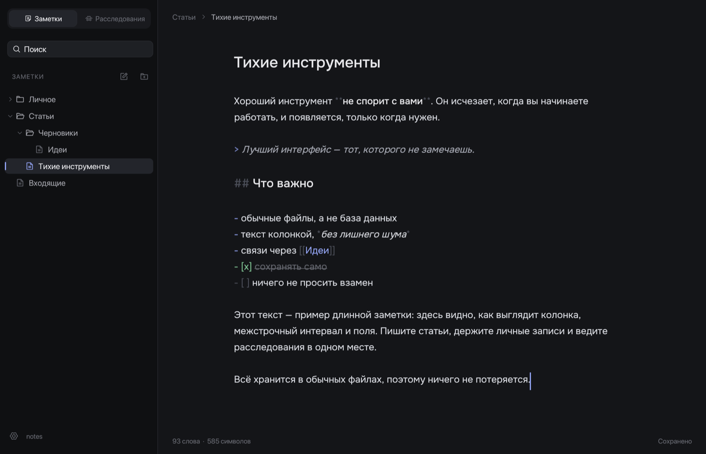
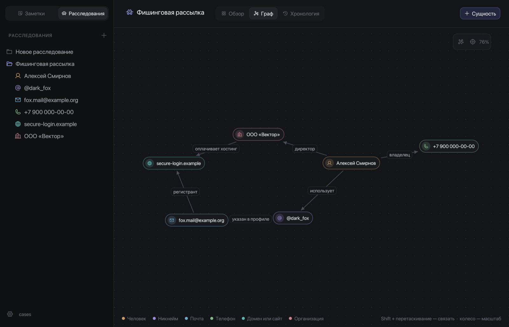
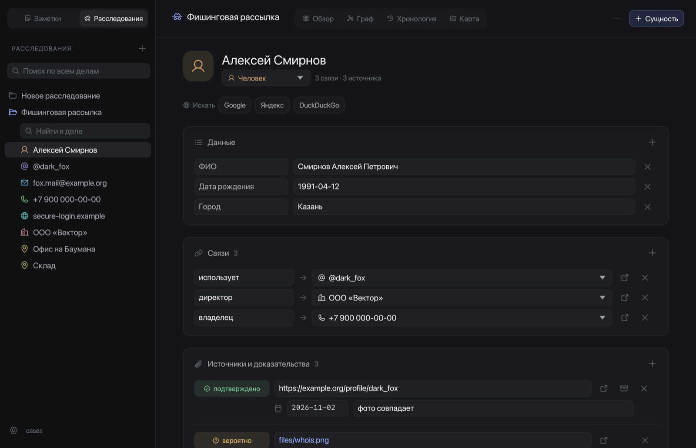
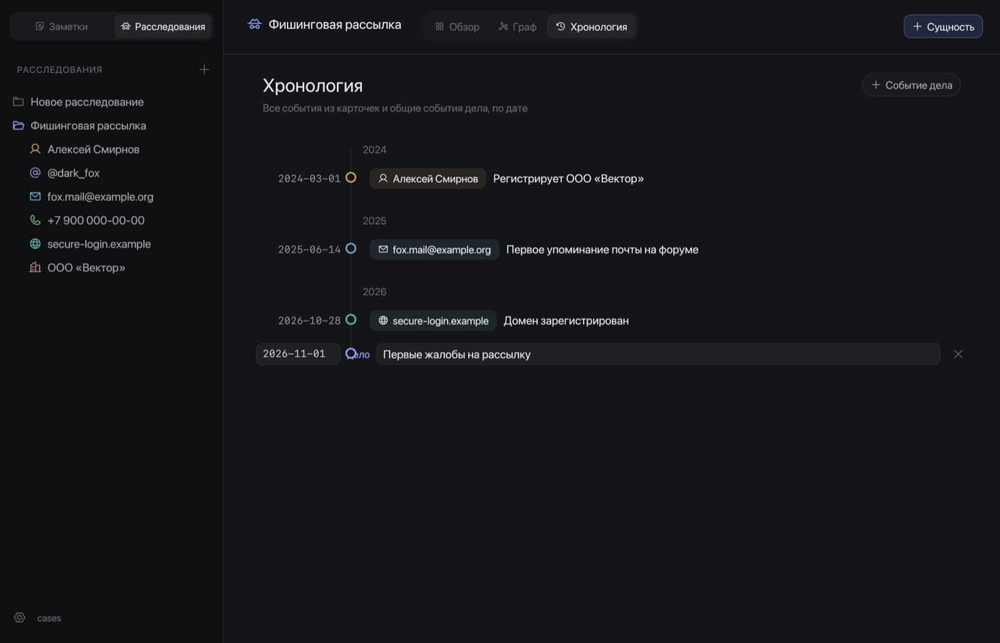

<p align="center">
  
</p>

<p align="center">
  <a href="https://github.com/aristocratonly/quiet-note/releases/latest"></a>
  
  
  <a href="https://aristocratonly.github.io/quiet-note/"></a>
</p>

<p align="center">
  Тихие заметки и OSINT-расследования в одном приложении.<br>
  Обычные файлы на вашем диске. Без облака, аккаунта и синхронизации.
</p>

<br>

## Скачать

| Система | Файл | |
|---|---|---|
| **macOS** (Apple Silicon) | [Quiet-Note-macOS.zip](https://github.com/aristocratonly/quiet-note/releases/latest/download/Quiet-Note-macOS.zip) | Приложение не подписано Apple. При первом запуске нажмите на нём правой кнопкой и выберите «Открыть». |
| **Windows** (64-бит) | [Quiet-Note-Windows-x86_64.zip](https://github.com/aristocratonly/quiet-note/releases/latest/download/Quiet-Note-Windows-x86_64.zip) | Распакуйте и запустите `Quiet Note.exe`. Если SmartScreen предупредит: «Подробнее» → «Выполнить в любом случае». |
| **Linux** (x86_64) | [Quiet-Note-Linux-x86_64.tar.gz](https://github.com/aristocratonly/quiet-note/releases/latest/download/Quiet-Note-Linux-x86_64.tar.gz) | `tar -xzf Quiet-Note-Linux-x86_64.tar.gz && ./quiet-note-linux/quiet-note`. Нужны GTK 3 и OpenGL, glibc 2.35+. |

Все версии — на странице [релизов](https://github.com/aristocratonly/quiet-note/releases).

<br>

## Заметки



Слева дерево папок, справа текст. Больше ничего.

- **Обычные файлы.** Каждая заметка — `.md` или `.txt` в папке `Документы/Quiet Notes`. Открывайте чем угодно, переносите, удаляйте. Папку можно сменить в настройках.
- **Сохраняется само.** Внизу — счётчик слов и отметка, что всё записано.
- **Дерево папок.** Перетаскивайте заметки и папки мышью: на папку — внутрь, на пустое место внизу — в корень.
- **Поиск** по названиям и тексту всех заметок.
- **Красивый текст.** Первая строка становится заголовком. Лёгкая разметка оживает прямо при письме: `# заголовок`, `**жирный**`, `*курсив*`, `- список`, `- [ ] задача`, `> цитата`, `` `код` ``, `[[ссылка]]`. В файле остаётся обычный Markdown.
- **Свои шрифты** встроены в приложение и выглядят одинаково на всех системах: Onest (без засечек) и Literata (с засечками), плюс моноширинный. Размер и ширина колонки настраиваются.
- **Плавность.** Мягкое появление заметок, плавная прокрутка и подсветка. Отключается в настройках.

<br>

## Расследования



Второй раздел — для OSINT-работы. Каждое дело — отдельная папка в `Документы/Quiet Investigations`.

<table>
  <tr>
    <td width="50%"></td>
    <td width="50%"></td>
  </tr>
  <tr>
    <td><b>Сущности.</b> Человек, никнейм, почта, телефон, домен, организация, место. В карточке — поля, связи, источники с датой и надёжностью, события и заметки.</td>
    <td><b>Хронология.</b> Все события дела по датам, сгруппированы по годам.</td>
  </tr>
</table>

- **Граф связей.** Узлы перетаскиваются, `Shift` + перетаскивание от узла к узлу создаёт связь, колесо меняет масштаб, волшебная палочка раскладывает граф сама.
- **Источники и доказательства.** Ссылка или приложенный файл — файлы копируются в папку дела.
- **Обзор** — заметки по делу и счётчики.

<details>
<summary>Как устроена папка дела</summary>

```
Фишинговая рассылка/
├── case.md              заметки по делу
├── entities/
│   ├── @dark_fox.md     карточка: шапка type / field / link / source / event + текст
│   └── ...
├── files/               доказательства
└── graph.pos            положение узлов на графе
```

Всё — обычный текст. Дело можно положить в git, зашифровать архивом или открыть в любом редакторе.
</details>

<br>

## Горячие клавиши

| | macOS | Windows / Linux |
|---|---|---|
| Новая заметка | <kbd>⌘</kbd> <kbd>N</kbd> | <kbd>Ctrl</kbd> <kbd>N</kbd> |
| Новая папка | <kbd>⇧</kbd> <kbd>⌘</kbd> <kbd>N</kbd> | <kbd>Shift</kbd> <kbd>Ctrl</kbd> <kbd>N</kbd> |
| Сохранить сейчас | <kbd>⌘</kbd> <kbd>S</kbd> | <kbd>Ctrl</kbd> <kbd>S</kbd> |
| Переименовать | двойной клик | двойной клик |
| Создать, переименовать, удалить | правый клик | правый клик |

<br>

## Сборка из исходников

Нужен [Rust](https://rustup.rs). На Linux ещё `libgtk-3-dev libxkbcommon-dev libgl1-mesa-dev libwayland-dev`.

```bash
git clone https://github.com/aristocratonly/quiet-note.git
cd quiet-note
cargo run --release
```

```bash
./build-app.sh                    # macOS: собрать dist/Quiet Note.app
cargo test                        # тесты
cargo test shots -- --ignored     # снимки экранов в target/shots
```

Сборки для Windows и Linux делает GitHub Actions при каждом новом релизе — см. [`.github/workflows/release.yml`](.github/workflows/release.yml).

<br>

<p align="center"><sub>Ваши файлы остаются вашими.<br>Шрифты Onest и Literata — под лицензией SIL Open Font License, см. <a href="assets/fonts">assets/fonts</a>.</sub></p>
