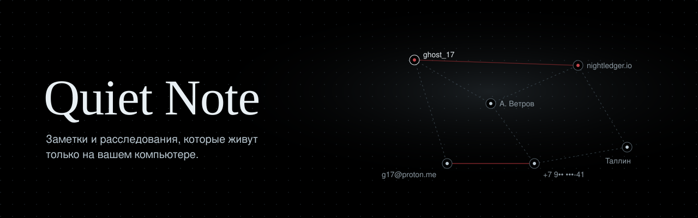
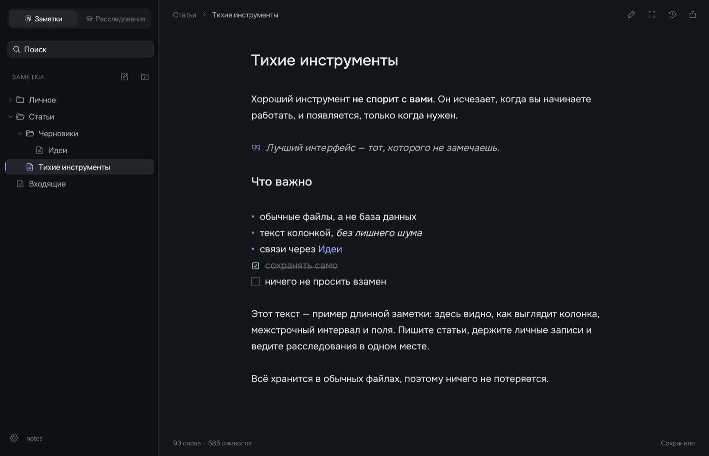
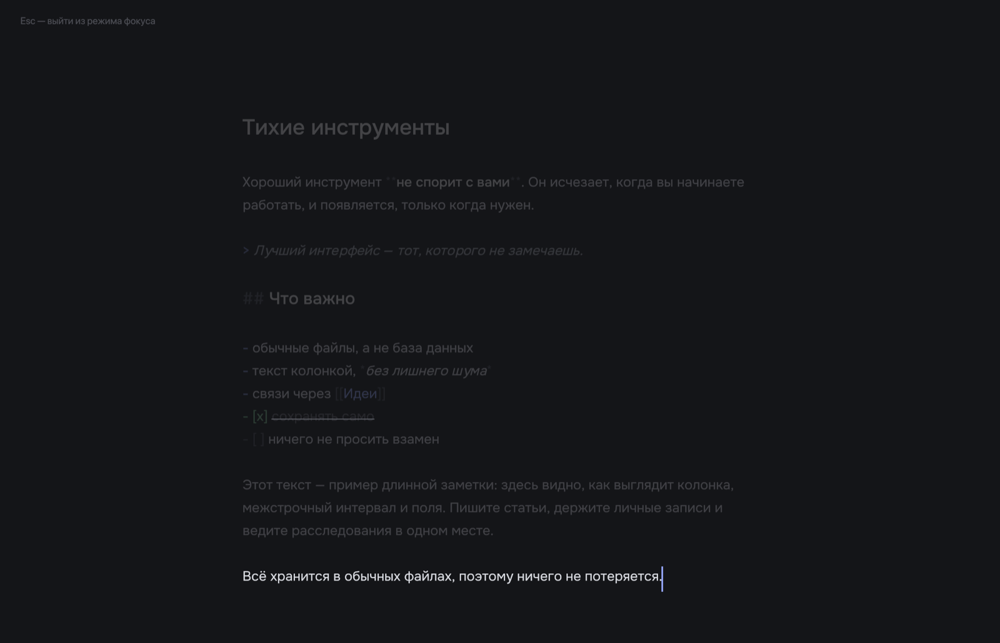
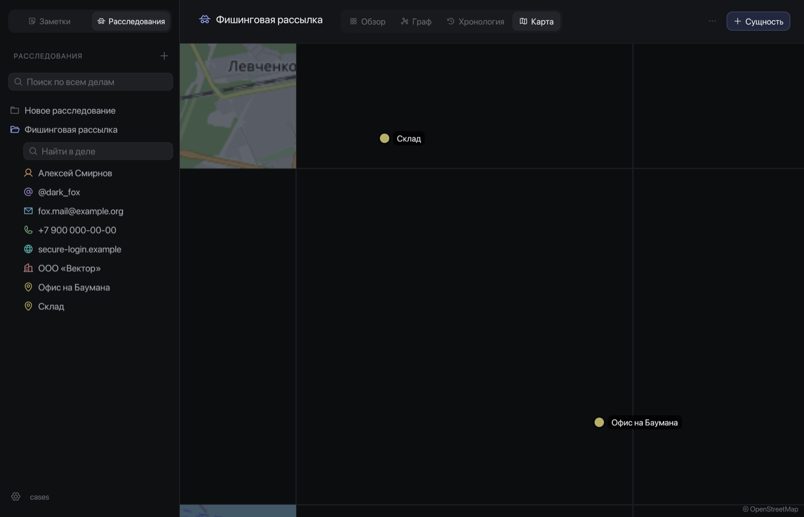
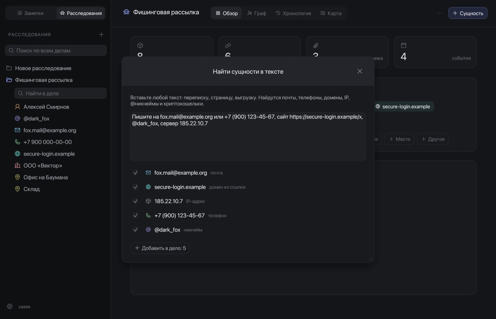
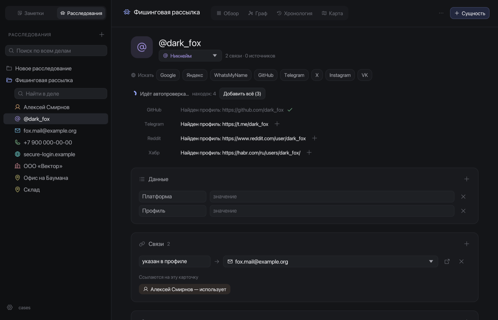

<p align="center">
  
</p>

<p align="center">
  <a href="https://github.com/aristocratonly/quiet-note/releases/latest"></a>
  
  
  <a href="https://aristocratonly.github.io/quiet-note/"></a>
</p>

<p align="center">
  Тихие заметки и OSINT-расследования в одном приложении.<br>
  Обычные файлы на вашем диске. Без облака, аккаунта и синхронизации.
</p>

<br>

## Скачать

| Система | Файл | |
|---|---|---|
| **macOS** (Apple Silicon) | [Quiet-Note-macOS.zip](https://github.com/aristocratonly/quiet-note/releases/latest/download/Quiet-Note-macOS.zip) | Приложение не подписано Apple. При первом запуске нажмите на нём правой кнопкой и выберите «Открыть». |
| **Windows** (64-бит) | [Quiet-Note-Windows-x86_64.zip](https://github.com/aristocratonly/quiet-note/releases/latest/download/Quiet-Note-Windows-x86_64.zip) | Распакуйте и запустите `Quiet Note.exe`. Если SmartScreen предупредит: «Подробнее» → «Выполнить в любом случае». |
| **Linux** (x86_64) | [Quiet-Note-Linux-x86_64.tar.gz](https://github.com/aristocratonly/quiet-note/releases/latest/download/Quiet-Note-Linux-x86_64.tar.gz) | `tar -xzf Quiet-Note-Linux-x86_64.tar.gz && ./quiet-note-linux/quiet-note`. Нужны GTK 3 и OpenGL, glibc 2.35+. |

Все версии — на странице [релизов](https://github.com/aristocratonly/quiet-note/releases).

<br>

## Заметки


Слева дерево папок, справа текст. Больше ничего, пока не понадобится.

- **Обычные файлы.** Каждая заметка — `.md` или `.txt` в папке `Документы/Quiet Notes`. Открывайте чем угодно, переносите, удаляйте.
- **Красивый текст.** Первая строка становится заголовком, разметка оживает прямо при письме: `# заголовок`, `**жирный**`, `*курсив*`, `- список`, `- [ ] задача`, `> цитата`, `` `код` ``. Встроенные шрифты Onest и Literata одинаковы на всех системах.
- **Ссылки `[[ ]]`.** ⌘ + клик открывает заметку, а если её нет — создаёт. Внизу заметки видно, кто на неё ссылается.
- **Быстрый переход ⌘P.** Пара букв названия — и заметка открыта.
- **Выделение нескольких.** Ctrl или ⌘ + клик отмечает заметки, папки, дела и сущности по одной; рамка мышью (с Ctrl/⌘ или с пустого места) — сразу несколько. Отмеченное можно перетащить в папку или отправить в корзину.
- **Назад.** Стрелка вверху, ⌘[ или боковая кнопка мыши возвращают туда, где вы были.
- **Свой курсор.** Тонкий прицел вместо системной стрелки; в настройках можно вернуть обычный.
- **Теги `#тег`.** Подсвечиваются в тексте и собираются в боковой панели: клик по тегу оставляет только его заметки.
- **Поиск** по названиям и тексту всех заметок.
- **Картинки.** Перетащите картинку в окно — она скопируется рядом с заметкой и появится в тексте.
- **История версий.** Копии сохраняются сами, не чаще раза в 5 минут. Любую можно посмотреть и вернуть.
- **Экспорт в PDF и HTML** с теми же шрифтами, картинки встраиваются в HTML.
- **Плавность** появления, прокрутки и подсветки. Отключается в настройках.

<table>
  <tr>
    <td width="50%"></td>
    <td width="50%"></td>
  </tr>
  <tr>
    <td><b>Режим чтения ⌘E.</b> Разметка прячется, картинки показываются, ссылки открываются обычным кликом.</td>
    <td><b>Режим фокуса ⇧⌘F.</b> Панели исчезают, всё, кроме текущего абзаца, уходит в тень. Esc — выйти.</td>
  </tr>
</table>

<br>

## Расследования


Второй раздел — для OSINT-работы. Каждое дело — отдельная папка в `Документы/Quiet Investigations`.

- **Сущности:** человек, никнейм, почта, телефон, домен, организация, место. В карточке — поля, связи, источники с датой и надёжностью, события и заметки.
- **Граф связей.** Узлы перетаскиваются, `Shift` + перетаскивание создаёт связь, волшебная палочка раскладывает граф сама.
- **Хронология** всех событий дела по годам.
- **Карта.** Места с координатами — точки на карте OpenStreetMap. Координаты можно найти по адресу прямо в карточке.
- **Шифрование паролем.** Карточки, заметки и приложенные файлы шифруются (XChaCha20-Poly1305, ключ из пароля через Argon2id). Имена сущностей на диске тоже скрыты. Пароль восстановить нельзя.
- **Сущности из текста.** Вставьте переписку или страницу — найдутся почты, телефоны, домены, IP, @никнеймы и криптокошельки, их можно добавить в дело одним нажатием.
- **Автопроверка.** Одна кнопка в карточке — и приложение само проверит сущность по открытым источникам, а находки добавятся в дело одним нажатием. Найденные профили и новые сущности сразу появляются на графе, связанные с исходной карточкой. Можно проверить сразу всё дело.
  - никнейм — есть ли профиль на GitHub, GitLab, Reddit, Telegram, Keybase, Хабре, Pikabu, Steam, Docker Hub и ещё 7 сайтах;
  - почта — профиль Gravatar (имя, никнейм, место, привязанные аккаунты), аккаунт GitHub с этой почтой, почтовые серверы домена и имя ящика как никнейм на всех 16 сайтах;
  - домен — DNS (IP, NS, MX, TXT), регистрация и регистратор (RDAP), поддомены из сертификатов, первая копия в веб-архиве;
  - телефон — международный формат и страна; IP — расположение, сеть и хост.
- **Ссылки на поиск** в каждой карточке: Google, Яндекс, WHOIS, архив, сертификаты, соцсети — по типу сущности. Открываются в браузере, само приложение никуда не ходит.
- **Копия страницы.** Источник-ссылку можно сохранить в дело файлом с датой — улика не пропадёт, если страницу удалят.
- **Поиск по всем делам** — например, встречался ли этот никнейм раньше.
- **Отчёт по делу** в PDF или Markdown: сущности, связи, источники и хронология.

<table>
  <tr>
    <td width="50%"></td>
    <td width="50%"></td>
  </tr>
  <tr>
    <td width="50%"></td>
    <td width="50%"></td>
  </tr>
</table>

<details>
<summary>Как устроена папка дела</summary>

```
Фишинговая рассылка/
├── case.md              заметки по делу
├── entities/
│   ├── @dark_fox.md     карточка: шапка type / field / link / source / event + текст
│   └── ...
├── files/               доказательства
└── graph.pos            положение узлов на графе
```

Всё — обычный текст. У зашифрованного дела вместо этого лежат файлы `.qenc` и `.quietlock`; названия приложенных файлов остаются видны.
</details>

<details>
<summary>Что уходит в интернет</summary>

Только по вашему действию: плитки карты (OpenStreetMap), поиск координат по адресу (Nominatim), скачивание страницы для копии и автопроверка (запросы к сайтам из списка выше идут напрямую с вашего компьютера, значение сущности видно этим сайтам). Ссылки на поиск открываются в вашем браузере.
</details>

<br>

## Горячие клавиши

| | macOS | Windows / Linux |
|---|---|---|
| Новая заметка | <kbd>⌘</kbd> <kbd>N</kbd> | <kbd>Ctrl</kbd> <kbd>N</kbd> |
| Новая папка | <kbd>⇧</kbd> <kbd>⌘</kbd> <kbd>N</kbd> | <kbd>Shift</kbd> <kbd>Ctrl</kbd> <kbd>N</kbd> |
| Сохранить сейчас | <kbd>⌘</kbd> <kbd>S</kbd> | <kbd>Ctrl</kbd> <kbd>S</kbd> |
| Найти заметку | <kbd>⌘</kbd> <kbd>P</kbd> | <kbd>Ctrl</kbd> <kbd>P</kbd> |
| Читать / писать | <kbd>⌘</kbd> <kbd>E</kbd> | <kbd>Ctrl</kbd> <kbd>E</kbd> |
| Режим фокуса | <kbd>⇧</kbd> <kbd>⌘</kbd> <kbd>F</kbd> | <kbd>Shift</kbd> <kbd>Ctrl</kbd> <kbd>F</kbd> |
| Открыть ссылку `[[ ]]` | <kbd>⌘</kbd> + клик | <kbd>Ctrl</kbd> + клик |
| Переименовать | двойной клик | двойной клик |
| Создать, переименовать, удалить | правый клик | правый клик |

<br>

## Сборка из исходников

Нужен [Rust](https://rustup.rs). На Linux ещё `libgtk-3-dev libxkbcommon-dev libgl1-mesa-dev libwayland-dev`.

```bash
git clone https://github.com/aristocratonly/quiet-note.git
cd quiet-note
cargo run --release
```

```bash
./build-app.sh                    # macOS: собрать dist/Quiet Note.app
cargo test                        # тесты
cargo test shots -- --ignored     # снимки экранов в target/shots
```

Сборки для Windows и Linux делает GitHub Actions при каждом новом релизе — см. [`.github/workflows/release.yml`](.github/workflows/release.yml).

<br>

<p align="center"><sub>Ваши файлы остаются вашими.<br>Шрифты Onest и Literata — под лицензией SIL Open Font License, см. <a href="assets/fonts">assets/fonts</a>.</sub></p>
